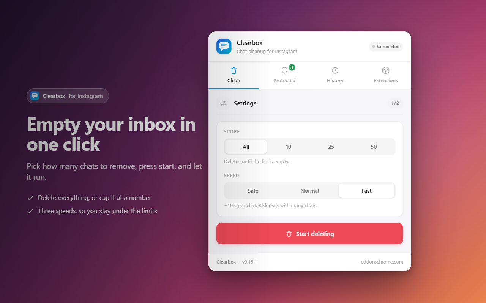
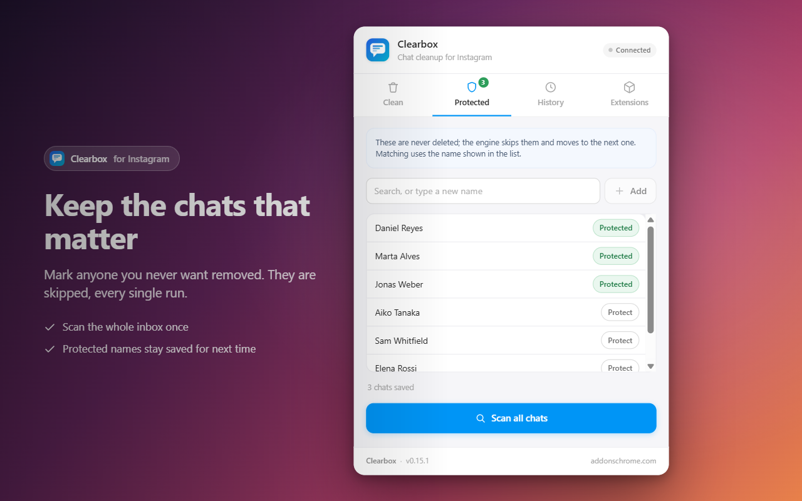

# Clearbox: Bulk Chat and Message Deleter for Instagram DMs

Clearbox is a free Chrome extension that clears an Instagram direct message inbox in bulk. Instagram lets you delete conversations only one at a time. Clearbox works through the inbox for you on the desktop site, skips the chats you marked as protected, and asks for confirmation before anything is removed.

**[Install from the Chrome Web Store](https://chromewebstore.google.com/detail/chpbjfedphdaaipgjdklhmddapjpanlj?utm_source=github&utm_medium=readme&utm_campaign=clearbox)** | **[Full guide and FAQ](https://www.addonschrome.com/extensions/clearbox-bulk-chat-message-deleter-for-instagram.html?utm_source=github&utm_medium=readme&utm_campaign=clearbox)** | **[Video demo](https://www.youtube.com/watch?v=t_7VPNwwCDk)**

This repository is the public home for Clearbox documentation, release notes and the issue tracker. The extension itself is distributed through the Chrome Web Store.

## Features

- Bulk delete conversations from your inbox
- Protected chats: the ones you mark are skipped every time
- Choose the scope: all chats, or only the first 10, 25 or 50
- Three speed settings
- A confirmation step before deleting starts
- Stop whenever you want
- A history log of what was removed
- Free, no account needed

## How to delete all Instagram messages at once

1. Install Clearbox from the [Chrome Web Store](https://chromewebstore.google.com/detail/chpbjfedphdaaipgjdklhmddapjpanlj?utm_source=github&utm_medium=readme&utm_campaign=clearbox).
2. Open your Instagram inbox in Chrome on your computer.
3. Mark the chats you want to keep as protected.
4. Choose the scope and the speed, then confirm.

The [full guide](https://www.addonschrome.com/extensions/clearbox-bulk-chat-message-deleter-for-instagram.html?utm_source=github&utm_medium=readme&utm_campaign=clearbox) explains each option.

## What actually gets deleted

Deleting a conversation removes it from your inbox only. The other person still has their copy of the chat. That is how Instagram works, and no tool changes it. If you want a message to disappear for both sides, you have to unsend that message.

Deleted conversations cannot be restored, so set your protected chats first.

## Pricing

Clearbox is free.

## Screenshots

## Support and feedback

Found a bug or want a feature? [Open an issue](../../issues) in this repository. Please include your Chrome version and the steps that led to the problem.

## Disclaimer

Clearbox is an independent tool. It is not affiliated with, endorsed by or sponsored by Instagram or Meta Platforms, Inc. Instagram is a trademark of Meta Platforms, Inc. and is used here only to describe what the tool works with.

---

Built and maintained by [Addons Chrome](https://www.addonschrome.com/?utm_source=github&utm_medium=readme&utm_campaign=clearbox).
